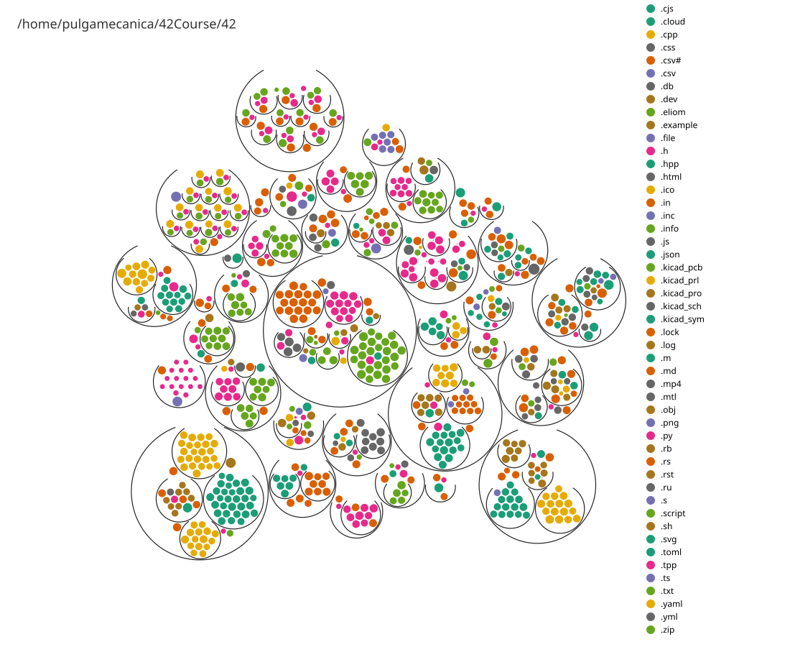

# 42 Projects

Every project here is a **submodule** pointing at its own repository in the
[42-Course](https://github.com/42-Course) organization. Nothing lives in this
folder directly — each project is big enough to own its history.

<p align="center">
  
</p>

<p align="center">
  <sub>Generated with <a href="https://github.com/pulgamecanica/lsphere">lsphere</a> —
  <code>lsphere . --svg -d 3 --palette tableau10 --bg "#0d1117"</code></sub>
</p>

---

Pull a single project instead of all 35:

```sh
git submodule update --init 42/scop
```

---

## Piscines

Immersive multi-week modules. Each one is itself an aggregator of its daily
modules, so cloning it recursively gets you every day.

| Project | Language | About |
| ------- | -------- | ----- |
| [Piscine-Object](https://github.com/42-Course/Piscine-Object) | C++ | Immersion into advanced C++ and object-oriented design (modules 00–05) |
| [Piscine-Django](https://github.com/42-Course/Piscine-Django) | Python | 42's Django piscine, from initiation to a final project |
| [Piscine-RoR](https://github.com/42-Course/Piscine-RoR) | Ruby | 42's Ruby on Rails piscine, from initiation to a final project |
| [Piscine-Embeded](https://github.com/42-Course/Piscine-Embeded) | C | Embedded piscine — bare-metal AVR, registers, timers, I²C, SPI |
| [Python-for-Data-Science](https://github.com/42-Course/Python-for-Data-Science) | Jupyter | Python piscine: arrays, DataFrames, OOP and data-oriented design |

## Systems & Low-Level

| Project | Language | About |
| ------- | -------- | ----- |
| [42sh](https://github.com/42-Course/42sh) | C | A full-featured shell, with real magical powers and projects installed |
| [ft_ls](https://github.com/42-Course/ft_ls) | C | `ls` reimplemented from the GNU Coreutils behaviour |
| [ft_nm](https://github.com/42-Course/ft_nm) | C | `nm` — list symbols from ELF object files |
| [ft_malloc](https://github.com/42-Course/ft_malloc) | C | A `malloc`/`free`/`realloc` implementation backed by `mmap` |
| [ft_script](https://github.com/42-Course/ft_script) | C | `script` — make a typescript of a terminal session |
| [ft_ssl_md5](https://github.com/42-Course/ft_ssl_md5) | C | MD5, SHA-256 and SHA-224 implemented from the specs |
| [ft_ping](https://github.com/42-Course/ft_ping) | C | `ping` over raw ICMP sockets |
| [ft_traceroute](https://github.com/42-Course/ft_traceroute) | C | `traceroute` via TTL-limited probes |
| [libasm](https://github.com/42-Course/libasm) | Assembly | libc primitives written in x86-64 Intel syntax |
| [ft_linux](https://github.com/42-Course/ft_linux) | Shell | A Linux distribution built from scratch (LFS), kernel included |

## Graphics & Games

| Project | Language | About |
| ------- | -------- | ----- |
| [scop](https://github.com/42-Course/scop) | C++ | A 3D `.obj` renderer written on Vulkan-Hpp |
| [Zappy](https://github.com/42-Course/Zappy) | C++ | Multiplayer game: server, GUI client and autonomous AI over TCP |
| [Gomoku](https://github.com/42-Course/Gomoku) | TypeScript | Gomoku AI with a visualizer and a game server |

## Web

| Project | Language | About |
| ------- | -------- | ----- |
| [matcha](https://github.com/42-Course/matcha) | TypeScript | A dating site built from the ground up — no ORM, no framework magic |
| [camagru](https://github.com/42-Course/camagru) | Ruby | Photo-editing and sharing site, webcam superimposition included |
| [hypertube](https://github.com/42-Course/hypertube) | Ruby | A streaming site that downloads torrents and serves them as video |
| [h42n42](https://github.com/42-Course/h42n42) | OCaml | A reactive browser game written in Ocsigen/Eliom |

## Cybersecurity

The CTF branch — four VMs, each level handing you the key to the next.

| Project | Language | About |
| ------- | -------- | ----- |
| [snow-crash](https://github.com/42-Course/snow-crash) | Shell | CTF I — the introduction to privilege escalation |
| [rainfall](https://github.com/42-Course/rainfall) | Shell | CTF II — binary exploitation, buffer overflows, ret2libc |
| [override](https://github.com/42-Course/override) | C | CTF III — the harder half of the exploitation ladder |
| [boot2root](https://github.com/42-Course/boot2root) | Rust | Build *and* break: harden a machine, then root someone else's |

## Algorithms, AI & Math

| Project | Language | About |
| ------- | -------- | ----- |
| [matrix](https://github.com/42-Course/matrix) | Rust | A public linear-algebra library — vectors, matrices, decompositions |
| [ft_linear_regression](https://github.com/42-Course/ft_linear_regression) | Rust | Linear gradient descent, implemented and visualized |
| [ft_turing](https://github.com/42-Course/ft_turing) | Rust | A Turing machine simulator, written functionally |
| [abstract_vm](https://github.com/42-Course/abstract_vm) | C++ | A stack-based VM interpreting a small assembly language |
| [agent-smith](https://github.com/42-Course/agent-smith) | Python | 42's agent project — I was the beta tester for it |

## Libraries

| Project | Language | About |
| ------- | -------- | ----- |
| [abstract_data](https://github.com/42-Course/abstract_data) | C++ | C++98-compliant reimplementation of the STL containers |
| [libftpp](https://github.com/42-Course/libftpp) | C++ | My first advanced C++17 multi-use library |

## Infrastructure & Hardware

| Project | Language | About |
| ------- | -------- | ----- |
| [cloud-1](https://github.com/42-Course/cloud-1) | Makefile | Ansible automation of a WordPress deployment on cloud infrastructure |
| [electronics-design](https://github.com/42-Course/electronics-design) | KiCad | A collaborative embedded board design — schematic and PCB |

---

_Piscine day/module repositories are intentionally not listed here — they are
submodules of their parent piscine repository above._
